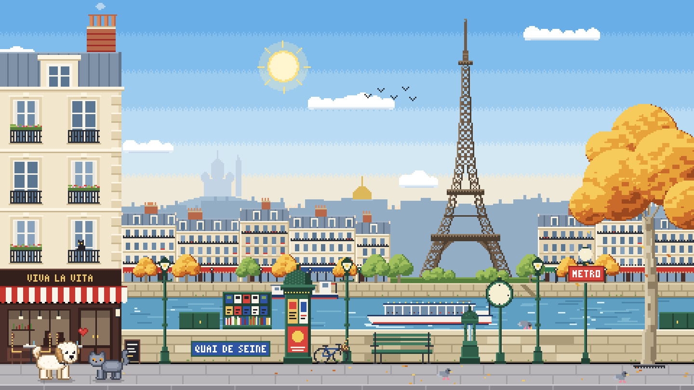
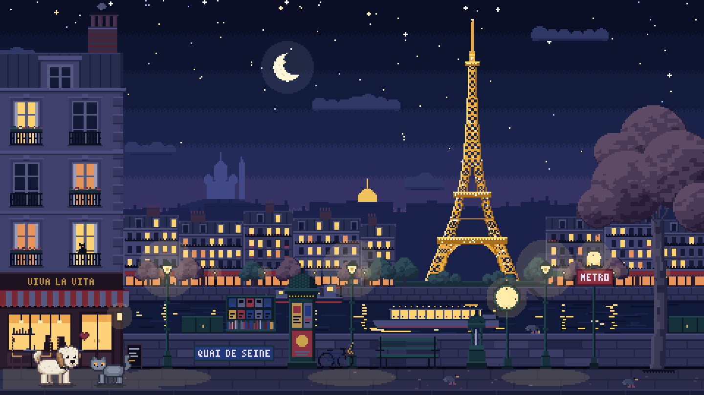
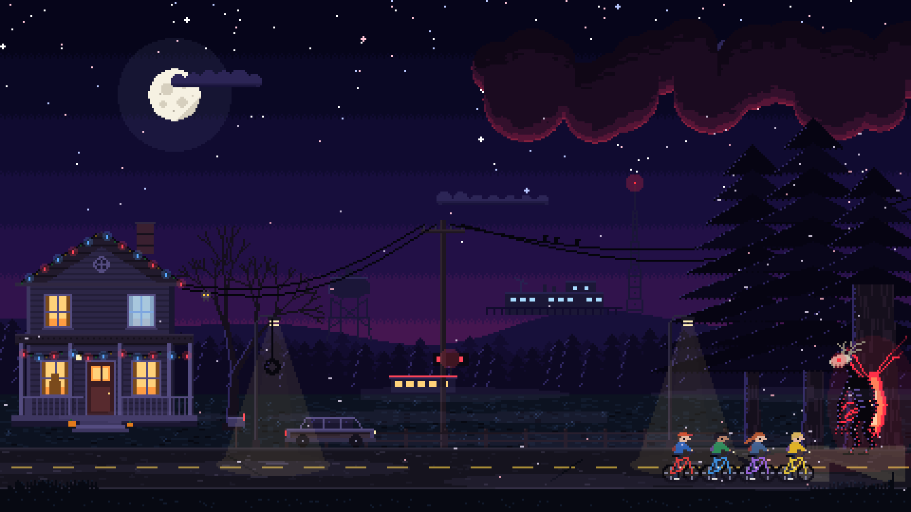

# decors-pixel

Deux décors en pixel art animé pour l'app desktop de Claude Code : le fond de la fenêtre devient une petite scène qui vit derrière la conversation, et les couleurs de l'app s'accordent avec elle.

- **Morkie à Paris** : un petit chien crème aux oreilles caramel et un chat gris-bleu aux yeux ambre se rencontrent sur un quai de Seine. Ils se flairent, sautillent, se courent après dans un sens puis dans l'autre, s'assoient côte à côte, et repartent chacun de son côté. Une fois par heure, à la demie, un rat traverse la rue : le chat puis le chien l'aperçoivent, sursautent et le prennent en chasse d'un bout à l'autre du quai, avant de s'asseoir, bredouilles. Derrière eux, la tour Eiffel, des immeubles haussmanniens, un café, des réverbères, un bateau-mouche, et une horloge de rue qui donne l'heure du poste. Le jour en mode clair, la nuit en mode sombre : la tour et les fenêtres s'allument, et la tour scintille cinq minutes à chaque heure pile, comme la vraie.
- **Frissons 80** : la lisière d'une petite ville, une nuit de novembre des années 80, dans l'esprit des films d'aventure et d'épouvante de l'époque. Quatre enfants à vélo, lampes allumées, roulent jusqu'à la forêt, tombent sur une bête à crâne de cerf sortie d'une faille rouge, et s'enfuient se regrouper devant une maison à la guirlande clignotante. Autour d'eux : un orage rouge et ses éclairs (l'un d'eux découpe une silhouette immense derrière la colline), un laboratoire et son projecteur, une antenne, des spores qui montent, de la brume, un écran cathodique par-dessus. Le décor reste de nuit ; le thème de l'app, lui, est clair ou sombre.

Version actuelle : **0.1.0**. Historique des versions : [CHANGELOG.md](CHANGELOG.md).

| Paris, le jour | Paris, la nuit |
|---|---|
|  |  |



## Installation

```bash
claude plugin install decors-pixel@mathis-plugins
```

Le plugin n'est pas activé d'office : il s'installe sur les postes où on veut le décor. Il demande un Claude Code qui connaît les thèmes (essayé avec la version 2.1.325, dans l'app et au terminal) ; avec une version plus ancienne, le mod ne se charge pas et le dit au démarrage de la session.

Le décor se voit dans l'app desktop et l'app mobile. Le terminal et les éditeurs ne dessinent pas de thème : la commande y répond, sans rien changer à l'écran.

## Utilisation

La commande `/decor` choisit le décor et le règle. Sans mot, elle dit où en sont les réglages.

| Commande | Effet |
|---|---|
| `/decor paris` | passe au décor Morkie à Paris (celui du départ) |
| `/decor frissons` | passe au décor Frissons 80 |
| `/decor auto` | le décor suit le mode de l'app, clair ou sombre (réglage de départ) |
| `/decor jour`, `/decor nuit` | le jour ou la nuit, quel que soit le mode de l'app |
| `/decor heure` | selon l'heure du poste : jour de 8 h à 21 h, nuit ensuite |
| `/decor voile 30` | règle le voile posé entre le décor et le texte, de 0 à 95 % : plus il est bas, plus le décor se voit ; à 0, les panneaux de l'app sont transparents |
| `/decor flou 2` | adoucit le décor derrière les panneaux, de 0 (pixels nets) à 16 |

| `/decor bandeaux non`, `/decor bandeaux oui` | resserre ou aère les lignes des bandeaux, au-dessus de la saisie |
| `/decor fond 55` | règle un voile de plus sous les bandeaux seuls, de 0 (aucun) à 95 % |
| `/decor rat` | rejoue tout de suite la poursuite du rat dans Paris, sans attendre la demie |

Le jour et la nuit ne veulent pas dire la même chose pour les deux décors. Pour Paris, ils changent la scène (le soleil ou la lune, la tour éteinte ou illuminée) et le thème de l'app avec elle. Pour Frissons 80, le décor reste de nuit : ils ne changent que le thème de l'app, clair ou sombre.

Plusieurs mots se suivent sur une ligne, lus dans l'ordre : `/decor frissons voile 40 flou 3`. Un mot inconnu annule toute la ligne.

Le voile et le flou se règlent par lumière (chaque décor, de jour et de nuit), et chacune garde les siens d'une session à l'autre. Au départ : 60 % et un flou de 5 pour Paris de jour, 60 % sans flou pour Paris de nuit, 70 % et un flou de 3 pour Frissons 80 en clair, 50 % et un flou de 2 en sombre. `/decor voile` et `/decor flou` changent ceux de la lumière affichée. En `auto`, le mod ne sait pas si l'app est en clair ou en sombre : il prend les réglages de la nuit.

Les bandeaux des autres mods, au-dessus de la saisie, sont aérés : un peu d'espace entre leurs lignes, pour qu'elles se détachent par-dessus le décor. `/decor bandeaux non` les resserre.

Ils peuvent aussi recevoir un voile à eux seuls, par-dessus celui de la fenêtre : `/decor fond`, gardé par lumière comme le voile et le flou. Au départ, aucun. Ce voile éclaircit ou assombrit la zone des bandeaux sans la flouter : le flou, lui, vaut pour toute la fenêtre, car le moteur ne sait pas flouter une zone plus qu'une autre.

## Limites connues

- `/decor jour`, `/decor nuit` et `/decor heure` demandent à l'app son thème clair ou sombre ; une app qui ne suit pas cette demande garde ses panneaux dans son propre mode. `/decor auto` les remet d'accord.
- Les fenêtres de permission gardent l'apparence de l'app.
- Quand un panneau s'ouvre à droite (un tableau de bord), l'app décale le texte de la discussion vers la gauche, mais pas le panneau voilé et flouté qu'elle pose dessous : une partie du texte se retrouve à nu sur le décor. C'est le dessin de l'app ; le thème ne règle ni la place ni la taille de ce panneau.
- Le voile et le flou valent pour tous les panneaux de l'app à la fois : le thème ne peut pas rendre transparente, ni flouter, une seule zone (la barre de saisie, par exemple).

- En clair, les bandeaux des autres mods restent pâles : ils portent des couleurs pensées pour un fond sombre.
- Le voile des bandeaux prend la teinte des panneaux de l'app, claire ou sombre. En `auto`, le mod ne sait pas quel mode l'app affiche : ce voile ne se pose pas.
- Un seul thème tient à la fois dans une session : un autre mod qui pose le sien remplace celui-ci.

## Architecture

```
decors-pixel/
├── .claude-plugin/plugin.json   manifeste (nom, version, contrat de types)
├── .claude-plugin/types/        types du moteur, pour tsconfig.json
├── hooks/
│   ├── hooks.json               déclare le module register.tsx
│   ├── register.tsx             le seul à parler au moteur : thème posé au démarrage, commande /decor, réglages gardés, dessin du fond, bandeaux aérés et leur voile
│   ├── palettes.js              généré : les couleurs de l'app sous chaque décor
│   ├── palettes.d.ts            généré : les types de palettes.js
│   ├── scene-paris.js           généré : le dessin de Paris (SVG) et ses couleurs de jour et de nuit
│   ├── scene-paris.d.ts         généré : les types de scene-paris.js
│   ├── scene-frissons.js        généré : le dessin de Frissons 80 (SVG)
│   └── scene-frissons.d.ts      généré : les types de scene-frissons.js
├── dessin/                      l'atelier des deux décors, hors du mod : rien d'ici n'est chargé par Claude Code
│   ├── build.mjs                assemble Paris, écrit hooks/scene-paris.js et ses aperçus
│   ├── frissons-build.mjs       assemble Frissons 80, écrit hooks/scene-frissons.js et son aperçu
│   ├── frissons-scene.mjs       Frissons 80, le décor : ciel, orage, collines, maison, forêt, route
│   ├── frissons-actors.mjs      Frissons 80, les acteurs : les enfants à vélo, la bête
│   ├── frissons-palette.mjs     Frissons 80, les couleurs du dessin
│   ├── couleurs.mjs             calcule les palettes, écrit hooks/palettes.js
│   ├── engine.mjs               grille de pixels, encodage SVG compact, export PNG
│   ├── palette.mjs              les couleurs du dessin, de jour et de nuit
│   ├── scene.mjs                le décor : ciel, tour, immeubles, quai, café, mobilier
│   ├── dog.mjs                  le chien : marche, course, arrêt, pose assise
│   ├── cat.mjs                  le chat : les mêmes poses, et le cœur
│   ├── rat.mjs                  le rat de la poursuite, et le point d'exclamation de qui l'aperçoit
│   ├── planche.mjs              planche de relecture des deux animaux, toutes poses en gros plan
│   └── emit.mjs                 écrit le module de scène
├── apercu/                      les images de ce README, écrites par les deux build
├── types/index.d.ts             contrat de l'état de session (`PluginState`) : l'habillage
├── tsconfig.json
└── tests/                       `claude plugin test`
    └── decors.test.tsx          les scènes, la commande, les réglages par décor, le mode heure, les palettes, l'horloge, le tour du rat (à la demie, et rejoué), les bandeaux aérés et leur voile
```

- **Un dessin, deux lumières.** La scène de Paris est dessinée une fois sur une grille de 480 × 270 pixels ; chaque couleur est une classe CSS. Le jour et la nuit ne changent que ces couleurs, plus quelques calques propres à l'un ou à l'autre (soleil, lune, étoiles, halos). En `auto`, une règle `prefers-color-scheme` choisit seule.
- **Sous la limite.** Un `Svg` de plus de 131 072 caractères est refusé en entier par le moteur. `dessin/build.mjs` encode un chemin par couleur, en déplacements relatifs, mesure le résultat et échoue au-delà de 126 000.
- **Deux scènes, hors de la colonne du texte.** L'app pose la conversation et la saisie au milieu de la fenêtre : le chien et le chat ne s'arrêtent et ne jouent que devant le café, à gauche, et entre le panneau du métro et l'arbre, à droite. Entre les deux, ils ne font que passer.
- **Aucun script.** Tout bouge par des animations CSS en `steps()`, pixel par pixel. Les décalages de chaque élément passent par des classes, jamais par un style en attribut.
- **L'heure sans script.** Les aiguilles de l'horloge sont deux traits qui tournent par une animation CSS, l'un en une heure, l'autre en douze. En dessinant le fond, `register.tsx` lit l'heure du poste et fait partir chaque animation d'autant de secondes qu'il s'en est écoulé (`timingCss`) : l'horloge reste juste tant que le fond n'est pas redessiné, et se remet à l'heure quand il l'est. Le scintillement de la tour est calé de même : une animation d'une heure, visible ses cinq premières minutes. La boucle du chien et du chat l'est aussi, comme ce qui dérive lentement (nuages, bateau, oiseaux, feuilles) : un fond redessiné reprend là où le précédent en était.
- **Une rencontre écrite à l'avance.** Le chien et le chat suivent chacun un scénario de 150 secondes, en boucle (`DOG_SCRIPT` et `CAT_SCRIPT` de `dessin/build.mjs`) : une suite de scènes qui donnent l'instant, le trajet, l'allure (marche, course, arrêt, assis) et le sens. `build.mjs` en tire les animations et refuse un trajet dont la durée ne colle pas à l'allure.
- **Un rat, une fois par heure.** La boucle dure 150 secondes, un diviseur de l'heure : calée sur l'heure du poste, elle commence un tour à chaque demie. Ce tour-là est remplacé par la poursuite (`DOG_RAT`, `CAT_RAT` et `RAT_SCRIPT` de `dessin/build.mjs`), qui commence et finit comme les autres, le chien hors champ à gauche et le chat à droite. Le rat et les images clés de la poursuite ne sont pas dans la scène ordinaire : `register.tsx` les y glisse le temps de ce tour, sous un nom de scène à lui (`paris-nuit-rat`), car c'est le changement de nom de la scène qui fait redessiner le fond par l'app. Une minuterie armée sur la demie pose ce nom, puis le retire à la fin du tour ; la poursuite ne se joue qu'une fois et s'arrête sur sa dernière image, la rue vide. `/decor rat` la rejoue aussitôt : le nom de la scène porte alors la seconde de son départ.
- **Les couleurs de l'app.** Une palette compte une centaine de couleurs par mode, aux noms du système de design de l'app. `dessin/couleurs.mjs` les tire de quelques teintes et refuse une palette que l'app ne peindrait pas.

## Développement

```bash
scripts/check.sh --quick decors-pixel   # pendant le travail
scripts/check.sh decors-pixel           # avant le push
```

Après un changement du dessin de Paris (`dessin/scene.mjs`, `dog.mjs`, `cat.mjs`, `palette.mjs`) ou du scénario de la rencontre :

```bash
node plugins/decors-pixel/dessin/build.mjs
node plugins/decors-pixel/dessin/build.mjs --relecture <dossier>   # aussi : gros plans PNG, et SVG à ouvrir dans un navigateur (les trois scènes, et la rencontre avancée à ses moments clés)
node plugins/decors-pixel/dessin/planche.mjs <dossier>             # les poses des deux animaux, en gros plan
```

Après un changement du dessin de Frissons 80 (`dessin/frissons-*.mjs`) ou de son scénario :

```bash
node plugins/decors-pixel/dessin/frissons-build.mjs
node plugins/decors-pixel/dessin/frissons-build.mjs --relecture <dossier>   # aussi : gros plans PNG, et SVG de la rencontre à ses moments clés
```

Après un changement d'une teinte de l'app, ou une mise à jour de Claude Code :

```bash
node plugins/decors-pixel/dessin/couleurs.mjs <chemin de make-colors.js>
```

`make-colors.js` est fourni par le skill `plugin-authoring` de Claude Code, qui affiche son dossier en se chargeant. Il change avec les versions et n'est pas dans ce dépôt.

Les fichiers générés de `hooks/` se commitent avec leur source.
